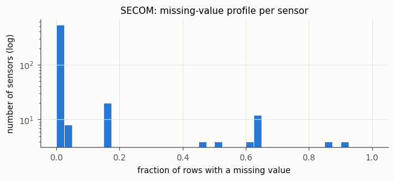
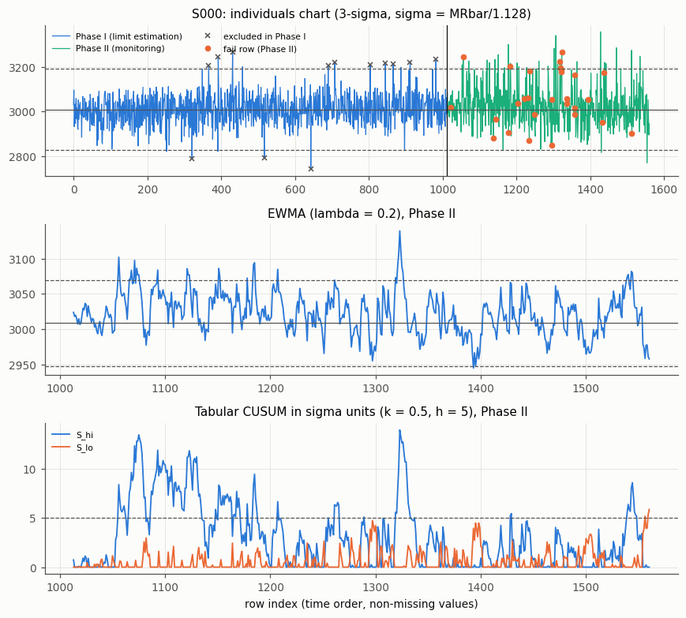
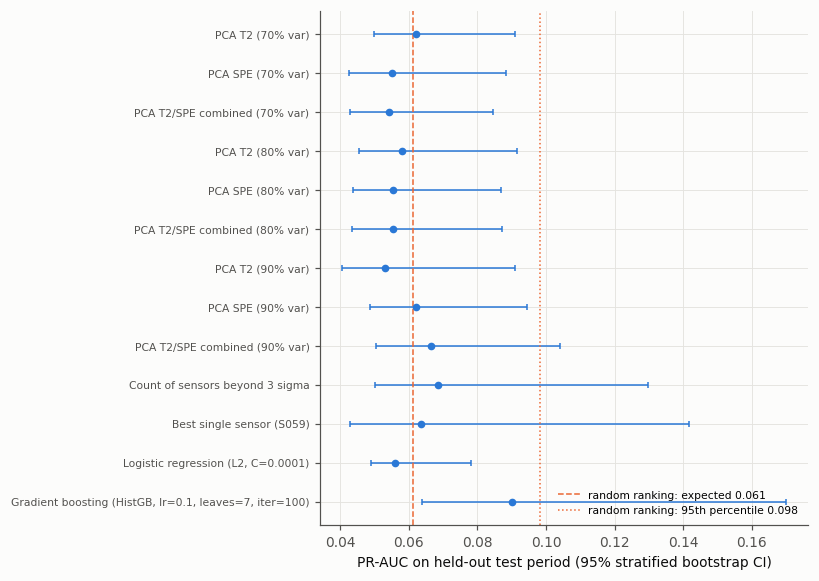
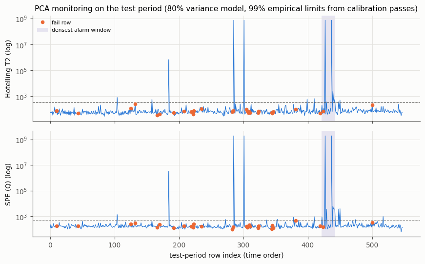
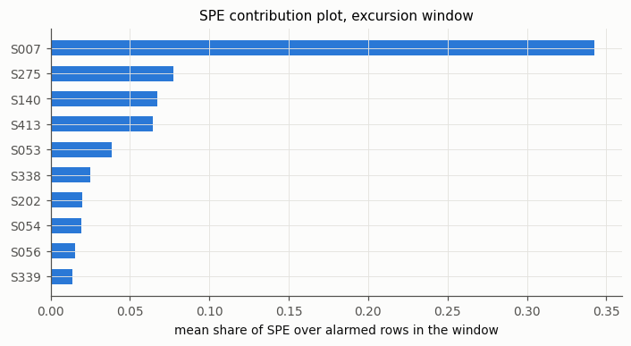
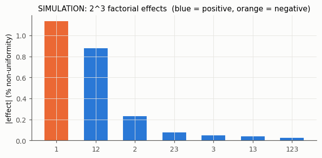
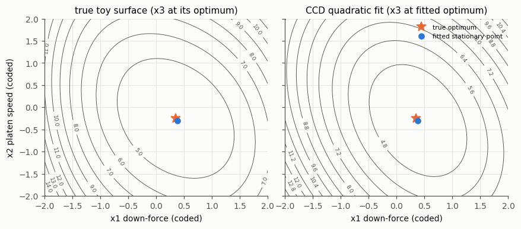
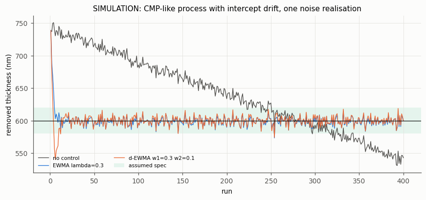
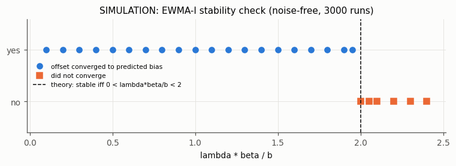

# fab-process-control

A personal portfolio project that works through the core toolkit of a
semiconductor process-control engineer on one public fab dataset and one
documented simulator:

| Area | What is here | Data |
|---|---|---|
| Data quality | missing-value profile, constant / near-constant sensors, imbalance, time coverage | SECOM (real, anonymised) |
| SPC | individuals / moving-range and X-bar/R charts, EWMA, tabular CUSUM, Western Electric rules, Cp/Cpk, Phase I vs Phase II | SECOM |
| Multivariate FDC | PCA Hotelling T² and SPE (Q) monitoring, contribution plots, compared with univariate baselines, logistic regression and gradient boosting on a time-based split and on three rolling-origin folds, with permutation tests | SECOM |
| DOE | 2^(4-1) screening, 2^3 factorial + centre points with ANOVA, rotatable central composite design, fitted vs true optimum | **simulation** |
| Run-to-run APC | EWMA and double-EWMA on a drifting process, each tuned on separate replications; published stability condition and drift bias checked numerically | **simulation** |
| FMEA / 8D | process FMEA with RPN for the simulated process; a worked 8D on an alarm cluster that the FDC actually raised in SECOM (a data-record fault, not a process excursion) | both |

Everything numeric in the results sections below is generated from the files
in `results/` by `python -m fabpc.cli report` (a test fails if this README is
out of date). Every external constant, rule and model form is cited with a URL
and retrieval date in [docs/sources.md](docs/sources.md).

## Why this shape

SECOM is one of the few public data sets from a real fab: 1,567 rows, 590
anonymised sensor columns, a pass/fail label and a timestamp per row. The
source calls each row "a single production entity"; it does not say whether
that is a wafer, a lot or a tool run, so this README says "row" throughout. It has
no specification limits, no sensor names, no tool context and no controllable
inputs, so it can show monitoring (SPC, FDC) but not control or DOE. Those two
are therefore done on a small simulator whose model form comes from the
run-to-run control literature. Simulation results are labelled as such
everywhere.

## Reproduce

```bash
python -m venv .venv && . .venv/bin/activate      # Windows: .venv\Scripts\activate
pip install -r requirements-lock.txt && pip install --no-deps -e .
python scripts/fetch_secom.py --dest data/secom    # downloads from UCI, checks SHA-256
export SECOM_DIR=data/secom                        # PowerShell: $env:SECOM_DIR = "data/secom"
python -m fabpc.cli all                            # results/*.json, results/figures/*.png, README tables (about 10-20 min, mostly the gradient-boosting grids)
pytest -q                                          # SECOM tests skip cleanly without the data
```

* `python -m fabpc.cli arl | doe | r2r | fmea` run the simulation parts without SECOM.
* Results are rounded to 10 significant digits before writing; the JSON and
  Markdown outputs were checked to be byte-identical on Windows (Python 3.11)
  and Linux (Python 3.12) - see "Verification" below.
* Raw SECOM files are not in the repository (`data/` is git-ignored).

## Evaluation design (leakage-safe)

SECOM rows are in time order (checked). They are cut into three contiguous blocks:

* **fit** (first 50 %): sensor filtering, imputation medians, scaling, PCA,
  model coefficients, SPC Phase I (together with cal);
* **cal** (next 15 %): T²/SPE control limits, every alarm threshold, the
  logistic-regression C and the gradient-boosting hyperparameters (small grids,
  chosen by calibration-period PR-AUC);
* **test** (last 35 %): touched once, for evaluation / Phase II monitoring.

The PCA reference set is the pass rows of the fit block. Thresholds are set
so that at most 5 % of calibration-period passes alarm (fewer when the score
has ties); the realised false-alarm rate on calibration and test passes is
reported next to recall. Because one split can mislead, the supervised and
PCA scores are also evaluated on three **rolling-origin folds** (each with its
own fit / cal / test blocks, everything refitted per fold). Tests
(`tests/test_secom_data.py`) corrupt all cal/test rows and check that nothing
fitted on the fit block changes, corrupt the test rows and check that all
limits, thresholds and hyperparameter choices stay the same, and do the same
for a rolling-origin fold.

## Results

### 1. Data quality - `results/data_profile.json`

<!-- BEGIN:data -->
| Item | Value |
|---|---|
| Rows (production entities) | 1567 |
| Sensor columns in `secom.data` | 590 (UCI page and `secom.names` say 591) |
| Fails / passes | 104 / 1463 (fail rate 6.6%) |
| Time span | 2008-07-19 11:55:00 to 2008-10-17 06:07:00 |
| Rows time-ordered / duplicate timestamps | True / 33 |
| Missing cells overall | 4.54% |
| Rows with at least one missing value | 1567 |
| Sensors with no missing value | 52 |
| Sensors > 50% missing | 28 |
| Constant sensors | 116 |
| Near-constant sensors (one value >= 95% of rows) | 126 |

The UCI page and secom.names say 591 features ('a 1567 x 591 matrix'); every row of secom.data has 590 fields. The discrepancy is in the source's own documentation.

Time-ordered split: fit = first 50% of rows, cal = up to 65%, test = the rest.

| Block | Rows | Fails | From | To |
|---|---|---|---|---|
| fit | 784 | 67 | 2008-07-19 11:55:00 | 2008-09-11 08:06:00 |
| cal | 235 | 9 | 2008-09-11 08:58:00 | 2008-09-22 22:15:00 |
| test | 548 | 28 | 2008-09-22 22:17:00 | 2008-10-17 06:07:00 |

Fail rate by month: 2008-07 22.2% (14/63), 2008-08 9.2% (51/555), 2008-09 2.9% (17/590), 2008-10 6.1% (22/359)
<!-- END:data -->



The fail rate is not stationary over time, which matters for any model
trained on the early months and evaluated on the later ones.

### 2. SPC - `results/spc_summary.json`

Three sensors were chosen by the largest |standardised mean difference|
between fail and pass rows in the fit block only. Phase I = fit + cal
(limits from MRbar/1.128, one pass of excluding points beyond 3 sigma);
Phase II = test. EWMA lambda = 0.2, L = 3; tabular CUSUM k = 0.5 sigma,
h = 5 sigma, both sides, signal on either: in-control ARL **about 465** for
normal data (930 per one-sided chart, the value in the NIST table; see the ARL
table below and docs/sources.md N5). **Spec limits are an
assumption**: SECOM has none, so LSL/USL = Phase-I mean +/- 4 Phase-I sigma
(Cp = 1.33 by construction if the I-MR sigma were the true sigma; N7). R1-R4 are the
Western Electric rules (R1 beyond 3 sigma, R2 2-of-3 beyond 2 sigma, R3
4-of-5 beyond 1 sigma, R4 8 in a row on one side).

<!-- BEGIN:spc -->
| Sensor | SMD (fit) | Phase I n / excluded | SD / sigma_MR | Phase II: R1 / R2 / R3 / R4 | EWMA / CUSUM signals | X-bar / R subgroups out (n = 5) | Cpk I -> II | Fail rate with / without R1 alarm (Fisher p) | R1 alarms high / low (fails among them) |
|---|---|---|---|---|---|---|---|---|---|
| S000 | -0.44 | 1013 / 13 | 0.99 | 31 / 32 / 9 / 2 (of 548) | 31 / 140 | 5 / 15 (of 109) | 1.34 -> 0.88 | 16.1% / 4.4% (p = 0.016) | 29 / 2 (5 / 0) |
| S021 | 0.44 | 1017 / 24 | 1.11 | 1 / 0 / 8 / 236 (of 548) | 16 / 516 | 0 / 0 (of 109) | 1.20 -> 1.51 | 0.0% / 5.1% (p = 1.000) | 1 / 0 (0 / 0) |
| S059 | 0.63 | 1014 / 67 | 1.46 | 1 / 0 / 68 / 258 (of 546) | 140 / 536 | 1 / 1 (of 109) | 0.91 -> 1.58 | 0.0% / 5.1% (p = 1.000) | 1 / 0 (0 / 0) |

Sensors whose Phase II rule-1 alarms are associated with fails at p < 0.05 (Fisher exact, no multiplicity correction, 3 sensors tested): S000.

Same test on all 408 kept sensors: 28 reach p < 0.05 (about 20.4 expected by chance if the tests were independent and exact); 0 pass the Bonferroni threshold p < 1.23e-04. Smallest p: S156 0.0002, S429 0.0002, S128 0.0005.
<!-- END:spc -->



Reading the table:

* SD / sigma_MR above 1 means the row-to-row moving range understates the
  total spread (slow drifts or autocorrelation inside Phase I). Charts built on
  MRbar then alarm on drift, which is the point of using them, but it also
  explains the many Phase I exclusions for the sensor with the largest ratio.
* For the two sensors dominated by rule 4 and by CUSUM signals, the Phase II
  mean has moved away from the Phase I centre; EWMA/CUSUM are designed to
  report exactly that, so "signals on most rows" means a sustained shift, not
  a broken chart. Cpk can still rise when the variance in Phase II is smaller.
* Out of control is not the same as yield loss: the Fisher test is the honest
  check, and it is weak. S000 is the only one of the three at p < 0.05, and its
  association runs the **opposite way to the reason it was chosen**: fails had
  lower S000 in the fit block (SMD -0.44), but almost all Phase II rule-1 alarms
  are on the high side and all the fails among alarmed rows are high-side
  alarms (last column).
* Repeating the same test on every kept sensor gives about as many p < 0.05 as
  chance would (count and Bonferroni result under the table), so the S000
  result is consistent with chance and is not a finding.

CUSUM run lengths (`results/cusum_arl.json`, simulation):

<!-- BEGIN:arl -->
| h | Shift (sigma) | NIST table (one chart) | Simulated one-sided ARL | Simulated two-sided ARL |
|---|---|---|---|---|
| 4 | 0.0 | 336.00 | 335.2 (SE 2.3) | 167.2 (SE 1.1) |
| 4 | 0.5 | 26.60 | 26.5 (SE 0.2) | 26.6 (SE 0.2) |
| 4 | 1.0 | 8.38 | 8.3 (SE 0.0) | 8.4 (SE 0.0) |
| 5 | 0.0 | 930.00 | 922.4 (SE 6.5) | 465.1 (SE 3.2) |
| 5 | 0.5 | 30.00 | 37.6 (SE 0.2) | 38.1 (SE 0.2) |
| 5 | 1.0 | 10.40 | 10.4 (SE 0.0) | 10.3 (SE 0.0) |

k = 0.5 sigma; 20000 simulated runs per cell, N(shift, 1) data, signal when the CUSUM exceeds h. Two-sided = S_hi and S_lo both run, signal on either (what the SPC section does).
<!-- END:arl -->

The NIST table gives the ARL of one one-sided chart. Running both sides
halves the in-control ARL and leaves the ARL for a shift in one direction
almost unchanged. The simulation reproduces every NIST entry except h = 5 at a
0.5-sigma shift (simulated about 37.6, NIST 30.0); the NIST in-control value
930 is reproduced within its Monte Carlo error.

### 3. Multivariate FDC vs supervised prediction - `results/fdc_results.json`

<!-- BEGIN:fdc -->
Test period: 548 rows, 28 fails (prevalence 0.051). No-skill PR-AUC reference = a random ranking of these rows: expected 0.061 (exact, Bestgen 2015), 95th percentile 0.098 (simulated) - not the prevalence. Alarm threshold per method = score quantile giving at most 5% false alarms on calibration-period passes (235 rows). CIs: 2000 stratified bootstrap resamples of the test period. p: one-sided label-permutation test (2000 permutations, seed 11), H0 = ranking unrelated to the label.

| Method | Recall at calibrated threshold | Cal / test FAR | PR-AUC | PR-AUC p | ROC-AUC | ROC-AUC p |
|---|---|---|---|---|---|---|
| PCA T2 (70% var) | 0.036 [0.000, 0.107] | 0.049 / 0.052 | 0.062 [0.050, 0.091] | 0.3668 | 0.574 [0.471, 0.673] | 0.1084 |
| PCA SPE (70% var) | 0.107 [0.000, 0.250] | 0.049 / 0.056 | 0.055 [0.043, 0.088] | 0.5682 | 0.498 [0.381, 0.613] | 0.5272 |
| PCA T2/SPE combined (70% var) | 0.000 [0.000, 0.000] | 0.049 / 0.052 | 0.054 [0.043, 0.085] | 0.5892 | 0.501 [0.385, 0.613] | 0.5002 |
| PCA T2 (80% var) | 0.071 [0.000, 0.179] | 0.049 / 0.054 | 0.058 [0.045, 0.091] | 0.4688 | 0.532 [0.425, 0.629] | 0.2949 |
| PCA SPE (80% var) | 0.036 [0.000, 0.107] | 0.049 / 0.056 | 0.055 [0.044, 0.087] | 0.5527 | 0.507 [0.385, 0.621] | 0.4543 |
| PCA T2/SPE combined (80% var) | 0.036 [0.000, 0.107] | 0.049 / 0.058 | 0.055 [0.044, 0.087] | 0.5522 | 0.505 [0.384, 0.619] | 0.4668 |
| PCA T2 (90% var) | 0.071 [0.000, 0.179] | 0.049 / 0.060 | 0.053 [0.041, 0.091] | 0.6362 | 0.470 [0.357, 0.579] | 0.7101 |
| PCA SPE (90% var) | 0.036 [0.000, 0.107] | 0.049 / 0.060 | 0.062 [0.049, 0.095] | 0.3588 | 0.554 [0.431, 0.667] | 0.1814 |
| PCA T2/SPE combined (90% var) | 0.036 [0.000, 0.107] | 0.049 / 0.058 | 0.067 [0.050, 0.104] | 0.2789 | 0.570 [0.449, 0.687] | 0.1144 |
| Count of sensors beyond 3 sigma | 0.071 [0.000, 0.179] | 0.035 / 0.021 | 0.068 [0.050, 0.130] | 0.1954 | 0.572 [0.462, 0.672] | 0.1064 |
| Best single sensor (S059) | 0.036 [0.000, 0.107] | 0.049 / 0.017 | 0.064 [0.043, 0.142] | 0.3328 | 0.496 [0.382, 0.612] | 0.5492 |
| Logistic regression (L2, C=0.0001) | 0.107 [0.000, 0.214] | 0.049 / 0.138 | 0.056 [0.049, 0.078] | 0.5427 | 0.563 [0.484, 0.641] | 0.1474 |
| Gradient boosting (HistGB, lr=0.1, leaves=7, iter=100) | 0.071 [0.000, 0.179] | 0.049 / 0.071 | 0.090 [0.064, 0.170] | 0.0680 | 0.645 [0.537, 0.749] | 0.0060 |

PCA models (fit on 717 fit-period pass rows, 408 sensors): 70% target -> 51 PCs (70.0%); 80% target -> 73 PCs (80.4%); 90% target -> 108 PCs (90.1%)

Permutation p < 0.05 for PR-AUC: none. For ROC-AUC: Gradient boosting (HistGB, lr=0.1, leaves=7, iter=100). After Bonferroni over the 13 methods (p < 0.0038): PR-AUC none; ROC-AUC none.

Calibration-period PR-AUC used for model selection - logistic regression C: 1e-06: 0.089, 1e-05: 0.092, 0.0001: 0.092, 0.001: 0.085, 0.01: 0.048, 0.1: 0.042, 1: 0.043. Gradient boosting: lr 0.05 / 7 leaves / 100 iter: 0.414; lr 0.05 / 7 leaves / 200 iter: 0.390; lr 0.05 / 15 leaves / 100 iter: 0.324; lr 0.05 / 15 leaves / 200 iter: 0.334; lr 0.1 / 7 leaves / 100 iter: 0.470; lr 0.1 / 7 leaves / 200 iter: 0.385; lr 0.1 / 15 leaves / 100 iter: 0.256; lr 0.1 / 15 leaves / 200 iter: 0.270.

| PCA model | T2 limit: empirical 99% [bootstrap 95% range] / Phase II F | test-pass exceedance (empirical / F) | SPE limit: empirical 99% [bootstrap] / Jackson-Mudholkar | test-pass exceedance (empirical / JM) |
|---|---|---|---|---|
| 70% var | 229.0 [118.7, 2829.1] / 85.1 | 0.025 / 0.079 | 652.8 [623.4, 17148.4] / 167.1 | 0.040 / 0.871 |
| 80% var | 324.9 [211.6, 4744.6] / 118.7 | 0.031 / 0.094 | 471.1 [436.1, 13603.5] / 110.0 | 0.048 / 0.975 |
| 90% var | 493.9 [326.6, 9483.6] / 176.2 | 0.033 / 0.144 | 317.8 [295.2, 8168.2] / 56.9 | 0.038 / 0.992 |

Empirical limits are the 99th percentile of 226 calibration-period passes, so each rests on the top two or three of them; the bracket is the 2.5-97.5% range over 2000 bootstrap resamples. Distribution-based limits use the 717 reference rows and assume normality.
<!-- END:fdc -->



What this says, plainly:

* **PCA T²/SPE scores do not rank fails better than a random ranking** at any
  model size (all permutation p above 0.1, PR-AUCs at the random-ranking
  expectation). That is expected: T²/SPE detect *abnormal sensor patterns*, and
  most fails here do not come with one (section 4: alarmed rows did not fail
  more often). The same holds for the univariate baselines.
* The no-skill line for PR-AUC is the random-ranking expectation (about 0.061
  here), not the prevalence (0.051): with only 28 fails, the average random
  ranking already scores above the prevalence (Bestgen 2015). Read against
  that line, **no method's PR-AUC is
  significant on this split**; gradient boosting comes closest (p about 0.07).
  Its ROC-AUC is the only one with p < 0.05, and it does not survive a
  Bonferroni correction over the 13 methods.
* Model selection on the calibration block is optimistic: the chosen
  gradient-boosting setting scored a calibration PR-AUC far above what it then
  achieved on the test block (selection table above).
* One split is one draw, so the supervised models and the PCA / count scores
  were re-run on three rolling-origin folds below.
* Thresholds calibrated on one period do not necessarily hold their
  false-alarm rate on the next: thresholds give **at most** 5 % on calibration
  passes (3.5 % for the count score, whose ties make an exact 5 % impossible),
  and the realised test FAR moves in both directions. That is the practical
  argument for periodic limit review in Phase II.
* The distribution-based limits (Phase II F for T², Jackson-Mudholkar for SPE)
  fit these data badly. Even on the reference passes they were built from, the
  1 % limits are exceeded by about 5-10 % of rows (`limits.*.exceed_theoretical`
  in the JSON), consistent with sensors far from normal; on later passes the JM
  SPE limit is exceeded by most rows, i.e. the residual space shifts between
  periods. This is why alarms use empirical limits set on the calibration
  block. The empirical 99 % limits are themselves unstable: they rest on the
  top two or three of 226 calibration passes, and their bootstrap range spans
  more than an order of magnitude.
* Between PCA and the simple univariate count of sensors beyond 3 sigma there
  is no difference worth the extra complexity on this data; that statement is
  about those two, not about supervised models.

#### 3b. Rolling-origin evaluation - `results/fdc_rolling.json`

Three chronological folds; in each, sensor filter, scaling, PCA, model
coefficients and hyperparameters (logistic-regression C, gradient-boosting
learning rate / leaves / iterations) are fitted on that fold's fit and cal
blocks only, and the test block is scored once. The "refit on fit + cal" rows
keep the hyperparameters chosen on cal and retrain on fit + cal, so the model
uses the most recent rows; the test block is still unseen.

<!-- BEGIN:fdc_rolling -->
| Fold | fit / cal / test rows | test fails | random-ranking PR-AUC | LR C (cal) | GB config (cal) |
|---|---|---|---|---|---|
| 1 | 548 / 236 / 235 (2008-09-11 to 2008-09-22) | 9 | 0.059 | 0.1 | lr 0.1, 15 leaves, 200 iter |
| 2 | 784 / 235 / 235 (2008-09-22 to 2008-10-02) | 11 | 0.067 | 0.0001 | lr 0.1, 7 leaves, 100 iter |
| 3 | 1019 / 235 / 313 (2008-10-02 to 2008-10-17) | 17 | 0.070 | 1e-06 | lr 0.1, 15 leaves, 100 iter |

| Method | Fold 1 PR-AUC (p) / ROC-AUC (p) | Fold 2 PR-AUC (p) / ROC-AUC (p) | Fold 3 PR-AUC (p) / ROC-AUC (p) | Mean PR-AUC (p) | Mean ROC-AUC (p) |
|---|---|---|---|---|---|
| PCA T2 (80% var) | 0.037 (0.8106) / 0.451 (0.7166) | 0.090 (0.1504) / 0.556 (0.2584) | 0.053 (0.7866) / 0.466 (0.6887) | 0.060 (0.5452) | 0.491 (0.5847) |
| PCA SPE (80% var) | 0.026 (0.9980) / 0.224 (0.9975) | 0.080 (0.2079) / 0.588 (0.1624) | 0.054 (0.7486) / 0.484 (0.5797) | 0.053 (0.7381) | 0.432 (0.9185) |
| Count of sensors beyond 3 sigma | 0.030 (0.9705) / 0.329 (0.9665) | 0.130 (0.0505) / 0.636 (0.0645) | 0.050 (0.8521) / 0.461 (0.7141) | 0.070 (0.2599) | 0.476 (0.7041) |
| Logistic regression (L2, C chosen on cal) | 0.041 (0.6762) / 0.476 (0.5812) | 0.046 (0.7706) / 0.470 (0.6462) | 0.078 (0.2684) / 0.645 (0.0250) | 0.055 (0.6907) | 0.531 (0.2804) |
| Gradient boosting (HistGB, chosen on cal) | 0.224 (0.0020) / 0.661 (0.0515) | 0.135 (0.0605) / 0.633 (0.0735) | 0.073 (0.3308) / 0.627 (0.0425) | 0.144 (0.0025) | 0.641 (0.0045) |
| Logistic regression (refit on fit + cal) | 0.042 (0.6462) / 0.511 (0.4403) | 0.046 (0.7906) / 0.486 (0.5887) | 0.100 (0.1149) / 0.698 (0.0040) | 0.063 (0.4833) | 0.565 (0.1000) |
| Gradient boosting (refit on fit + cal) | 0.299 (5.0e-04) / 0.590 (0.1719) | 0.051 (0.6542) / 0.515 (0.4503) | 0.071 (0.3728) / 0.560 (0.2234) | 0.140 (0.0030) | 0.555 (0.1334) |

p: one-sided label permutation within each fold (2000 permutations); for the means, the labels are permuted independently in every fold and the fold means recomputed.
<!-- END:fdc_rolling -->

* **Gradient boosting tuned on cal shows a small but repeatable skill**: its
  ROC-AUC is 0.63-0.66 in every fold (each fold on its own has too few fails
  to be decisive, p between about 0.04 and 0.07), and the fold-averaged PR-AUC
  and ROC-AUC are significant under the within-fold permutation test. Its PR-AUC
  varies a lot between folds, and retraining it on fit + cal does not help
  consistently.
* Logistic regression is at chance in the first two folds and only clears it in
  the last one (test = the last 20 % of rows), most clearly when refitted on
  fit + cal, i.e. trained on the first 80 % of rows. The calibration-period
  PR-AUC is flat for C at or below about 1e-4: as C goes to 0 the ranking
  converges, so the selected C sitting at the low end of the grid does not mean
  a still smaller C would rank differently.
* PCA T²/SPE and the count of sensors beyond 3 sigma stay at chance.
* So the headline is narrower than "nothing predicts SECOM fails": **unsupervised
  monitoring scores do not predict the fail label; a tuned tree ensemble has a
  small, real ranking skill; linear models are unstable across periods.** None
  of this is good enough to act on a single row.

### 4. Excursion found by the FDC and the 8D - `results/excursion.json`

<!-- BEGIN:excursion -->
- Densest window of PCA alarms in the test period: 20 consecutive rows, 2008-10-09 14:15:00 to 2008-10-11 08:27:00: 7 alarms (T2 6, SPE 7) vs 0.99 expected at the test-period alarm rate (4.9%).
- Is that window unusual? The densest of the 529 windows is the maximum of many counts, so it is compared with the same maximum after placing the 27 test-period alarms at random positions (20000 simulations): mean maximum 3.90, 95th percentile 5, P(maximum >= 7) = 0.0020.
- Fails in the window: 1 (5.0%) vs test-period fail rate 5.1%. Across the whole test period, alarmed rows failed at 0.0% (27 rows) vs 5.4% for non-alarmed rows.
- Top SPE contributors (mean share of SPE over alarmed rows in the window): S007 34.3% (window mean z = -16.8), S275 7.8% (window mean z = 4574.1), S140 6.7% (window mean z = 4414.5), S413 6.4% (window mean z = 5.1)
<!-- END:excursion -->




The cluster is genuinely unusual for this monitor (the scan-statistic line
above compares it with the densest window under random placement of the same
alarms), but it is not a yield event. The worked 8D report is in
[docs/8D_example.md](docs/8D_example.md). Because SECOM sensors are anonymous,
its root cause is stated at the level of sensors, rows and signal signatures:
on a handful of rows a group of four sensors jumps to values thousands of
reference ranges away; on those rows and on three neighbouring ones another
sensor reads exactly 0.0, and on the neighbouring ones the group is missing -
one data-record fault class. All
such rows in the data set fall between 5 and 12 October 2008, in the test
block, and are passes.
The conclusion is a data-acquisition / record-integrity problem rather than a
process excursion; no physical cause is invented.

### 5. DOE on the simulator - `results/doe_results.json`  (SIMULATION)

Toy response: within-wafer non-uniformity (%) as a smooth, deliberately
**non-quadratic** function of four coded factors; factor 4 has no effect by
construction. Noise SD is known, so the fitted optimum can be scored against
the true one.

<!-- BEGIN:doe -->
Screening, 2^(4-1) resolution IV, I=1234, 2 replicates (16 runs):

| Term | Effect | p |
|---|---|---|
| x1 downforce | -1.229 | 0.0000 |
| x2 platen_speed | 0.306 | 0.0008 |
| x3 slurry_flow | 0.104 | 0.1144 |
| x4 conditioner_sweep | -0.023 | 0.7060 |
| 12+34 (aliased) | 0.953 | 0.0000 |
| 13+24 (aliased) | -0.099 | 0.1292 |
| 14+23 (aliased) | -0.046 | 0.4567 |

Screening terms with p < 0.05: 1, 2, 12+34. Kept for the next stage (p < 0.2): downforce, platen_speed, slurry_flow.

How reliable is one screen? Over 2000 repeated screens with fresh noise, the share of screens that keep each factor at p < 0.2 (at p < 0.05): conditioner_sweep 21.2% (4.7%), downforce 100.0% (100.0%), platen_speed 98.9% (89.1%), slurry_flow 51.7% (21.4%). All three active factors kept and the inert one dropped: 39.4%.

Full factorial + centre points: centre mean 4.184 vs factorial mean 6.151; curvature term p = 4.76e-11.

| CCD result | Value |
|---|---|
| Quadratic fit R^2 / residual SD | 0.974 / 0.289 (true noise SD 0.15) |
| Fitted stationary point (coded x1..x4) | 0.383, -0.299, -0.089, 0.000 (minimum) |
| True optimum (coded) | 0.350, -0.250, -0.058, 0.000 |
| Distance fitted vs true (coded units) | 0.066 |
| True response at fitted point vs true minimum | 4.0086 vs 4.0066 (regret 0.0020) |
| Model prediction at fitted point / mean of 5 confirmation runs | 4.030 / 4.001 |
| Regret of simply taking the best observed CCD run | 0.1109 |
| Over 200 repeated CCD experiments: median / 90th pct distance | 0.084 / 0.149 |
| ... median / 90th pct regret (RSM vs best observed run) | 0.0033 / 0.0098 vs 0.1109 / 0.1109 |
| ... share of repeats where the best observed run is a centre point | 100.0% |
<!-- END:doe -->




* The 2^(4-1) screen finds factor 4 inactive in this run, but its large
  "12+34" term can only be read as the 1x2 interaction because factor 4 is
  known to be inert - the alias is real.
* Slurry flow acts mostly through curvature, which a two-level screen cannot
  see. This run kept it under the liberal 0.20 rule, but the repeated screens
  above show that was luck: with 16 runs at this noise level the screen keeps
  slurry flow only about half the time (a fifth of the time at 0.05) and keeps
  the inert factor about a fifth of the time. The screen is under-powered for
  a curvature-dominated factor; more replicates or centre points in the screen
  would be needed before trusting a "drop".
* The quadratic model's residual SD is larger than the true noise SD, i.e. the
  second-order model has lack of fit (the toy is not quadratic). The fitted
  optimum is still close to the true one.
* The "best observed run" comparison is a weak baseline: in every repeat the
  best observed CCD run is a centre point (last row), so it amounts to "run the
  design centre". Beating it shows the fitted model adds something, not that
  RSM beats a sensible alternative such as a sequential search.

### 6. Run-to-run control on the simulator - `results/r2r_results.json`  (SIMULATION)

Model form (Wang & He 2008; Chen & Guo 2001): `y_n = alpha + beta*u_n + n*delta + eps_n`,
u = polish time, y = removed thickness. EWMA with intercept updating,
`a_n = lambda*(y_n - b*u_n) + (1-lambda)*a_(n-1)`, `u_(n+1) = (T - a_n)/b`;
d-EWMA adds a drift estimate `p_n`. The model gain b deliberately underestimates
the true gain (plant-model mismatch).

<!-- BEGIN:r2r -->
Process: y = 35.0 + 4.0 u + n*(-0.5) + N(0, 6.0^2); model gain b = 3.4, target 600.0, assumed spec [580.0, 620.0]; 200 replications x 400 runs, first 50 runs discarded. Mean over replications (2.5-97.5 percentile across replications in brackets).

Fixed, untuned settings (illustration):

| Controller | lambda*beta/b | Mean offset (theory) | SD | RMSE | % in spec |
|---|---|---|---|---|---|
| no control | - | 28.143 | 50.97 | 58.16 [57.58, 58.93] | 22.8 |
| EWMA lambda=0.1 | 0.118 | -4.243 (-4.250) | 6.19 | 7.50 [7.15, 7.86] | 99.4 |
| EWMA lambda=0.3 | 0.353 | -1.416 (-1.417) | 6.62 | 6.76 [6.33, 7.28] | 99.7 |
| EWMA lambda=0.6 | 0.706 | -0.708 (-0.708) | 7.46 | 7.48 [6.91, 8.10] | 99.2 |
| d-EWMA w1=0.3 w2=0.1 | - | 0.001 | 7.28 | 7.27 [6.76, 7.83] | 99.4 |

Largest |simulated mean offset - theory| over the EWMA rows: 0.007 nm.

Tuned comparison: each controller's weights chosen by mean RMSE on 100 selection replications (seeds 50000-50099; EWMA 11 lambda values, d-EWMA 49 (w1, w2) pairs), then evaluated on the 200 independent replications above (seeds 1000-1199).

| Controller | Chosen setting | RMSE, selection reps | RMSE, evaluation reps | On grid edge |
|---|---|---|---|---|
| EWMA | EWMA lambda=0.25 | 6.71 | 6.71 [6.30, 7.21] | no |
| d-EWMA | d-EWMA w1=0.15 w2=0.01 | 6.39 | 6.40 [5.97, 6.86] | no |

Paired difference (tuned d-EWMA minus tuned EWMA) on the evaluation replications: -0.316 nm (95% CI -0.321 to -0.311); d-EWMA lower in 100.0% of replications.

Stability check: theory (stable iff 0 < lambda*beta/b < 2) and noise-free simulation agree at 26 of 26 grid points.
<!-- END:r2r -->




* EWMA leaves a steady offset under drift that matches the prediction
  `b*delta/(beta*lambda)` (see the gap reported under the first table); larger
  lambda shrinks the offset but passes more noise through, so RMSE is U-shaped
  in lambda.
* Read alone, the first table suggests that a mid-range EWMA beats d-EWMA.
  That is an artefact of comparing three EWMA settings with one arbitrary
  d-EWMA setting and **does not hold**: once both are tuned on separate
  replications, d-EWMA with a small drift weight has the lower RMSE in every
  evaluation replication (second table). It removes the drift offset and, with
  w2 small, adds little variance. Bias-free is not automatically best, but
  here, tuned, it is.
* The d-EWMA here is Chen & Guo's modified form (eq. 12), not the classic
  predictor-corrector (PCC) double EWMA of Butler & Stefani (1994); see
  docs/sources.md R3-R4.
* The published stability condition is reproduced on every grid point,
  including the marginal case lambda*beta/b = 2 (bounded oscillation that never
  converges).

### 7. FMEA - `docs/fmea.md`, `results/fmea.json`

Top rows (full table, rating scales and caveats in [docs/fmea.md](docs/fmea.md)):

<!-- BEGIN:fmea -->
| Failure mode | S x O x D = RPN | After action |
|---|---|---|
| Removal rate drifts down over pad life | 7 x 8 x 4 = 224 | 7 x 8 x 2 = 112 |
| Measurement missing or late | 5 x 5 x 7 = 175 | 5 x 5 x 4 = 100 |
| Controller oscillates or diverges | 8 x 3 x 6 = 144 | 8 x 2 x 3 = 48 |
| Controller removes drift too slowly | 5 x 6 x 4 = 120 | 5 x 3 x 4 = 60 |
<!-- END:fmea -->

The ratings are judgement for an illustrative simulated process, not plant data.

## Verification

* Unit tests check the implementations against the worked examples in the
  NIST/SEMATECH e-Handbook (individuals chart, EWMA, tabular CUSUM and its ARL
  table, 2^(4-1) run list, CCD alpha, stationary point), against scikit-learn
  (PR-AUC, ROC-AUC), against Bestgen's exact random-ranking AP examples,
  against Monte Carlo (Jackson-Mudholkar SPE limit, scan-statistic null on a
  case with a known answer) and against hand-computed controller steps.
* Mutation testing (`scripts/mutate.py`) injects deliberate bugs one at a
  time and requires the test suite to fail; the result is in
  [docs/mutation_report.md](docs/mutation_report.md).
* Golden tests regenerate every results JSON and compare bytes.
  `scripts/repro_check.py` regenerates everything (JSON, Markdown, PNG) and
  compares it with `results/`; reports from Windows and from Linux (WSL) are in
  [docs/repro/](docs/repro/). JSON and Markdown are byte-identical across the
  two; PNGs are pixel-identical but not byte-identical, because the two zlib
  builds compress the same pixels differently.
* One reproducibility bug was found this way: the "true optimum" of the DOE
  toy came from a numerical optimiser whose last digits differed between
  platforms; it is now computed in closed form (`doe_study.true_optimum`) and
  checked against the optimiser in a test.

## Limitations

* SECOM sensors and steps are anonymous; no physical interpretation is
  possible, and the pass/fail label is a downstream in-house test whose link to
  these sensors is weak.
* The test block has few fails (see the FDC table), so every recall estimate
  moves in coarse steps of one row; the bootstrap CIs show this.
* Spec limits, all simulator parameters, the toy DOE surface and the FMEA
  ratings are assumptions, stated where they are used.
* The PCA monitor has no data-validity gate (the 8D's main finding); it is
  kept as is so the published numbers stay reproducible.
* Only the EWMA-I stability condition is taken from the literature; the d-EWMA
  settings were only checked numerically, and the R2R ranking holds for this
  simulated drift and noise level only.
* Hyperparameter grids are small and selection uses calibration blocks with
  6-11 fails, so the chosen settings are noisy; the rolling-origin table shows
  how much they change between folds.
* Permutation p-values are reported per method without a family-wise
  correction in the tables; the Bonferroni result over the methods is stated
  under the FDC table.

## Data attribution

SECOM data: McCann, M. & Johnston, A. (2008). SECOM [Dataset]. UCI Machine
Learning Repository. <https://doi.org/10.24432/C54305>. Licensed under
[CC BY 4.0](https://creativecommons.org/licenses/by/4.0/). This repository does
not redistribute the data set; derived statistics and figures are in
`results/`. One exception: `results/excursion.json` (`signatures[*].window_values`)
contains the raw values of 7 sensors for the 20 rows of the excursion window
(140 values, missing values as `null`), taken unchanged from `secom.data` apart
from rounding to 10 significant digits, which does not alter any of them. They
are used under the same CC BY 4.0 licence with the attribution above.

## Layout

```
src/fabpc/      secom.py (loading, split, preprocessing)  spc.py  mspc.py  metrics.py
                secom_analysis.py  simulator.py  doe.py  doe_study.py  r2r.py  r2r_study.py
                fmea.py  plots.py  report.py  cli.py
scripts/        fetch_secom.py  mutate.py  repro_check.py
tests/          unit, golden and (data-dependent, auto-skipped) SECOM tests
results/        JSON results, summary.md, figures/
docs/           sources.md  8D_example.md  fmea.md  mutation_report.md  repro/ (Windows / Linux reports)
requirements-lock.txt   fully pinned environment used for results/
```
